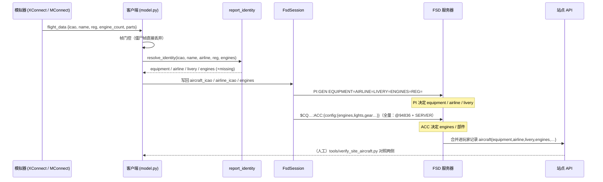

# 站点 aircraft 四字段：通道模型与修复

> 适用范围：`equipment` / `airline` / `livery` / `engines` 在站点在线列表里
> 显示 null（或长时间不更新）。XConnect（X-Plane）与 MConnect（MSFS）共用
> 同一套 Python 上报链路，桥只提供原料，字段拼装全在客户端。

## 1. 先分清两条通道

站点那四个字段不是一条报文带上去的：

| 字段 | 唯一来源 | 报文 | 承载键 |
|---|---|---|---|
| `equipment` | 客户端 | `#SB<cs>:<to>:PI:GEN` | `EQUIPMENT=` |
| `airline` | 客户端 | 同上 | `AIRLINE=` |
| `livery` | 客户端 | 同上 | `LIVERY=` |
| `engines` | 客户端 | `$CQ<cs>:<to>:ACC:<json>` | `config.engines` |

**PI 里没有 engines** —— swift 的 `PlaneInformation::toTokens()` 只拼
`EQUIPMENT` / `AIRLINE` / `LIVERY` 三对（`src/core/fsd/planeinformation.cpp`）。
所以「PI 里明明有 `ENGINES=2`，站点却是 null」不是矛盾：服务器（与 swift
一样）按 `KEY=VALUE` 逐对解析，不认识 `ENGINES` 键就忽略。

推论：**engines 只能靠 ACC**。凡是"前三个有值、engines 恒 null"的现象，
一定是 ACC 没被服务器采纳，而不是 PI 写错了。

## 2. 历史上踩过的四个坑（都已在代码里堵死）

| # | 坑 | 表现 | 现在的防线 |
|---|---|---|---|
| 1 | 断线幽灵帧 | 位置 `(0.0004150, 0.0139740)`、机型空、尾号空的一帧被当成真数据 → 发出 `PI:GEN:AIRLINE=SJX` → 服务器整块覆盖 | 坐标 ≤0.05° 且机型/机模名/尾号全空才判废；机型识别为空时**不清空**已上报机型（`model.py`） |
| 2 | 桥报 `engine_count=0` | 机型未加载完时 `if eng > 0` 直接跳过 → PI 无 `ENGINES=`、ACC 无 `engines` | `report_identity` 用 swift 机型库台数兜底；ACC 缺失时补"全关"掩码 |
| 3 | LIVERY 缺失 | 机型码查不到 swift id → 旧代码仍发 `ENGINES=` 占错槽位 | `plane_info()` 在 EQUIPMENT 与 LIVERY 都空时返回空串；`_send()` 跳过空报文 |
| 4 | **ACC 只发 `@94836`** | PI 发给 `SERVER` 被采纳（前三个字段有值），ACC 只进广播地址 → engines 恒 null | 全量 ACC 同时发 `@94836` + `SERVER`；被 004 拒绝则自动退回仅广播 |

第 4 条是本次的主因：两条通道发给了**不同的目标**，症状刚好一半好一半坏。

## 3. 组件时序（一次登录到站点可见）



## 4. 出问题时的 30 秒定位

```bat
python tools\verify_site_aircraft.py
```

读日志里最近一条 `[report] <呼号> PI …`，打印四个字段与缺失项：

```
[report] SJX110 PI EQUIPMENT=A320 AIRLINE=SJX LIVERY=SWIFT_A672-B-8493 ENGINES=2 REG=B-8493
```

- 带 `missing=…` → **本机**没算出来，看同段的机型推断日志；
- 四个都有值 → 本机没问题，用 `--online --token <Bearer>` 拉站点记录对照：

```bat
python tools\verify_site_aircraft.py --online --token <站点登录 token>
```

判读表：

| 本机 | 站点 | 结论 |
|---|---|---|
| 有 | 有 | 正常 |
| 有 | null（仅 engines） | ACC 未采纳 → 查日志 `[parts] full ACC -> SERVER` 与 `服务器不接受直发 SERVER 的 ACC` |
| 有 | null（前三个） | 服务器未采纳 PI → 查是否被残缺 PI 覆盖过（历史记录需重新连线刷新） |
| null | null | 本机解析失败 → 看 `missing=` 与机型库是否覆盖该机型 |

## 5. 相关日志（三级 + 上报自检）

| 级别 | 前缀 | 出处 | 含义 |
|---|---|---|---|
| ① 桥原始值 | `raw:` | `XConnect/datarefs.c`、`MConnect/datadefs.c` | 灯/gear/flaps/onGround/引擎数与机型 |
| ② 组装后 | `[report] … PI …` | `fsd/session.py::_audit_pi` | 实际要发出去的四个字段（含缺失项） |
| ② 组装后 | `[parts] acc json: …` | `fsd/session.py::notify_aircraft_parts` | 增量 ACC 全文 |
| ② 组装后 | `[parts] full ACC -> SERVER（engines=n 台）` | `fsd/session.py::_broadcast_full_aircraft_config` | 全量 ACC 是否进了服务器通道 |
| ③ 渲染端 | `anim:` | `XConnect/players.c`、`MConnect/players.c` | 对端最终动画值 |

## 6. 代码索引

| 文件 | 职责 |
|---|---|
| `xfly_client/report_identity.py` | 四个字段的唯一解析点（值对象 + 纯函数 + `audit()`） |
| `xfly_client/fsd/packet.py` | `plane_info()` 线序、`caps_response()` 能力声明 |
| `xfly_client/fsd/session.py` | PI 发送与自检、ACC 双通道、CAPS 应答、004 自愈降级 |
| `xfly_client/model.py` | 帧门控、身份刷新、换机型/尾号触发重发 |
| `tools/verify_site_aircraft.py` | 本机发放 vs 站点存储对照 |

## 7. 本机身份采集口径（MC / XC 对照表）

| 站点字段 | 客户端解析 | MConnect 来源 | XConnect 来源 | 备注 |
|---|---|---|---|---|
| `equipment` | `normalize_icao` → `guess_designator` | `TITLE` 目录反查 → `ATC TYPE` → `ATC MODEL`，全部过 `catalog_canonical_icao` | `acf_ICAO`（空则不猜，交客户端用 `acf_ui_name` 反查） | `ATC*` 占位符两侧都当"未知" |
| `airline` | 配置 → 呼号前三字 | 未上报（客户端兜底） | 未上报（客户端兜底） | 后续可用 `ATC AIRLINE` 作第二来源 |
| `livery` | `aircraft_db.swift_livery()` + 尾号 | 同左 | 同左 | 依赖 swift 机型库有该 designator |
| `registration` | 手动 → 模拟器 → 上次记录 | `ATC ID`（形状像尾号才算）→ `TITLE` 尾号 | 涂装目录名 → `acf_tailnum` | 两侧都拒绝把呼号/机型码当尾号 |
| `engines`（台数） | 桥实测 → swift 机型库 | `NUMBER OF ENGINES` → 会话最大台数 → 在转最高编号 → 0 | `acf_num_engines` → 同上 | 0 = 未知，整键不发 |
| `engines`（1..n 状态） | `AircraftParts` 1-based dict | `GENERAL ENG COMBUSTION:1..4` ∨ `N1>5%` | `ENGN_running` ∨ `N1>5%` | 键必须是字符串 `"1"` |
| `lights`（服务器 6 灯） | 9 灯归一化后裁到 6 | 5 个逐灯 SimVar ∨ `LIGHT ON STATES` 位掩码；logo/wing/recog/cabin 走 AUX | 亮度数组 ∨ 开关标量；logo/wing 仅 B738 走泛化槽位 | 掩码位见 `datadefs.c` 的 `LT_BIT_*` |
| gear / flaps / spoilers / onGround | `AircraftParts` | 双来源取最大（TOTAL ∨ ANIMATION ∨ HANDLE）、实际襟翼百分比 | `deploy_ratio` 数组最大值、`flaps_ratio` | NaN 一律消毒，否则整包 ACC 被丢弃 |

### 已知限制（不是 bug，写清楚免得反复追）

1. **X-Plane 的 logo / wing 灯**：XP 没有跨机型的标准 dataref，只有
   `generic_lights_brightness_ratio`，其槽位语义由机模 OBJ 定义。目前只有
   B738/B737 有槽位表（`light_profile_737`），其余机型报 0（保守不误报）。
   要扩展就得像 `radio.json` 那样逐机模登记槽位。
2. **MSFS 的 `LIGHT ON STATES` 掩码**：完全自绘灯光、连总线都不写的机模
   （少数）掩码恒 0，此时退回逐灯 SimVar，可能仍然全灭 —— 需按机模加 LVar
   覆盖（已有 IniBuilds A350 的先例）。
3. **airline**：桥不提供航司，客户端用"配置 → 呼号前缀"。用他家涂装但呼号
   是自己航司时会不一致（站点显示呼号航司）。要精确就得把 `ATC AIRLINE`
   透传上来，属于下一轮改动。

## 8. 遗留事项（服务端侧，客户端无法单方面解决）

- 站点 `aircraft.engines` 的最终写入逻辑在服务器：若它对 `$CQ…:SERVER:ACC`
  也忽略，则只能靠服务器侧改为采纳 ACC（本客户端已把 ACC 送到它能收的
  两个目标，并在被拒时自动降级）。
- 站点 `controller` / `isVirtual` 对**所有**用户都是 null，属服务端管制员
  字段，客户端没有上报路径。
- 冷门机型（swift 机型库不覆盖）的 `livery` 只能是 null：`LIVERY` 的
  `A<id>` 段依赖库内 id，伪造一个会让服务器反查机型失败，比 null 更糟。